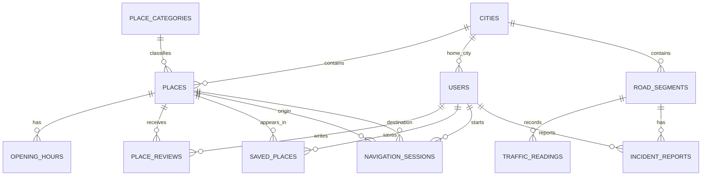

# Schema Design – Google Maps Navigation Database

## 1. Database Overview

The database is designed to support a Google Maps-like navigation platform. It stores information about cities, places, users, reviews, saved places, road segments, traffic readings, navigation sessions and road incidents.

The database uses PostgreSQL and the `gmaps` schema. The design uses appropriate data types, primary keys, foreign keys, unique constraints and check constraints to maintain data integrity.

The schema contains 11 tables and was designed using the supplied CSV files.

### 1.1 Data loaded

| Table | Rows loaded |
|---|---:|
| cities | 10 |
| place_categories | 12 |
| users | 40,000 |
| places | 40,042 |
| road_segments | 2,000 |
| opening_hours | 252,266 |
| place_reviews | 89,998 |
| saved_places | 50,000 |
| traffic_readings | 250,000 |
| navigation_sessions | 200,000 |
| incident_reports | 12,000 |
| **Total** | **936,328** |

All 11 CSV files were loaded successfully using `sql/02_load_data.sql`. The row counts matched the expected counts.

## 2. Data Dictionary

The database contains 11 tables. The data types and constraints were selected based on the supplied CSV data and the requirements of the navigation system.

### 2.1 Cities

| Column | Data type | Constraint | Purpose |
|---|---|---|---|
| city_id | INTEGER | Primary key | Identifies each city. |
| city_name | VARCHAR(100) | NOT NULL, UNIQUE | Stores the city name. |
| center_lat | NUMERIC(9,6) | NOT NULL, CHECK (-90 to 90) | Stores the city's central latitude. |
| center_lng | NUMERIC(9,6) | NOT NULL, CHECK (-180 to 180) | Stores the city's central longitude. |

### 2.2 Place Categories

| Column | Data type | Constraint | Purpose |
|---|---|---|---|
| category_id | INTEGER | Primary key | Identifies each category. |
| category_name | VARCHAR(80) | NOT NULL, UNIQUE | Stores the category name. |

### 2.3 Users

| Column | Data type | Constraint | Purpose |
|---|---|---|---|
| user_id | INTEGER | Primary key | Identifies each user. |
| display_name | VARCHAR(100) | NOT NULL | Stores the user's display name. |
| email | VARCHAR(254) | NOT NULL, UNIQUE | Stores a unique email address. |
| home_city_id | INTEGER | Foreign key, nullable, ON DELETE SET NULL | Links the user to their home city when available. |
| is_local_guide | BOOLEAN | NOT NULL | Indicates whether the user is a local guide. |
| guide_level | SMALLINT | Nullable, CHECK (1 to 10 for guides; NULL otherwise) | Stores the guide's level. |
| created_at | TIMESTAMPTZ | NOT NULL | Records when the account was created. |

### 2.4 Places

| Column | Data type | Constraint | Purpose |
|---|---|---|---|
| place_id | INTEGER | Primary key | Identifies each place. |
| plus_code | VARCHAR(20) | NOT NULL, UNIQUE, CHECK (format) | Stores the place's Plus Code. |
| name | VARCHAR(200) | NOT NULL | Stores the place name. |
| category_id | INTEGER | NOT NULL, FK to place_categories | Identifies the place category. |
| city_id | INTEGER | NOT NULL, FK to cities | Identifies the city containing the place. |
| latitude | NUMERIC(9,6) | NOT NULL, CHECK (-90 to 90) | Stores the place's latitude. |
| longitude | NUMERIC(9,6) | NOT NULL, CHECK (-180 to 180) | Stores the place's longitude. |
| address | TEXT | NOT NULL | Stores the address. |
| phone | VARCHAR(30) | Nullable | Stores the contact number when available. |
| website | TEXT | Nullable | Stores the website when available. |
| price_level | SMALLINT | Nullable, CHECK (1 to 4) | Represents the price category. |
| avg_rating | NUMERIC(2,1) | Nullable, CHECK (1 to 5) | Stores the displayed average rating. |
| review_count | INTEGER | NOT NULL, CHECK (>= 0) | Stores the displayed review count. |
| is_permanently_closed | BOOLEAN | NOT NULL | Indicates whether the place is permanently closed. |
| created_at | TIMESTAMPTZ | NOT NULL | Records when the place was added. |

### 2.5 Opening Hours

| Column | Data type | Constraint | Purpose |
|---|---|---|---|
| place_id | INTEGER | Part of composite PK, FK to places | Identifies the place. |
| weekday | SMALLINT | Part of composite PK, CHECK (1 to 7) | Identifies the weekday. |
| opens | TIME | NOT NULL | Stores the opening time. |
| closes | TIME | NOT NULL, CHECK (opens <> closes) | Stores the closing time. |

The composite primary key `(place_id, weekday)` prevents duplicate opening-hour records for the same place and weekday.

### 2.6 Place Reviews

| Column | Data type | Constraint | Purpose |
|---|---|---|---|
| review_id | INTEGER | Primary key | Identifies each review. |
| place_id | INTEGER | NOT NULL, FK to places | Identifies the reviewed place. |
| user_id | INTEGER | NOT NULL, FK to users | Identifies the reviewer. |
| rating | SMALLINT | NOT NULL, CHECK (1 to 5) | Stores the rating. |
| review_text | TEXT | Nullable | Stores the written review. |
| photo_count | SMALLINT | NOT NULL, CHECK (>= 0) | Stores the number of photos attached. |
| created_at | TIMESTAMPTZ | NOT NULL | Records when the review was submitted. |

The combination `(place_id, user_id)` is unique, allowing one review per user for each place.

### 2.7 Saved Places

| Column | Data type | Constraint | Purpose |
|---|---|---|---|
| user_id | INTEGER | Part of composite PK, FK to users | Identifies the user saving the place. |
| place_id | INTEGER | Part of composite PK, FK to places | Identifies the saved place. |
| list_name | VARCHAR(40) | Part of composite PK, NOT NULL, CHECK (allowed list names) | Identifies the user's list. |
| saved_at | TIMESTAMPTZ | NOT NULL | Records when the place was saved. |

The composite primary key is `(user_id, place_id, list_name)`. This allows a place to appear in different lists belonging to the same user.

### 2.8 Road Segments

| Column | Data type | Constraint | Purpose |
|---|---|---|---|
| segment_id | INTEGER | Primary key | Identifies each road segment. |
| road_name | VARCHAR(200) | NOT NULL | Stores the road name. |
| city_id | INTEGER | NOT NULL, FK to cities | Identifies the city containing the road. |
| road_type | VARCHAR(20) | NOT NULL, CHECK (allowed types) | Stores the road classification. |
| start_lat | NUMERIC(9,6) | NOT NULL, CHECK (-90 to 90) | Stores the starting latitude. |
| start_lng | NUMERIC(9,6) | NOT NULL, CHECK (-180 to 180) | Stores the starting longitude. |
| end_lat | NUMERIC(9,6) | NOT NULL, CHECK (-90 to 90) | Stores the ending latitude. |
| end_lng | NUMERIC(9,6) | NOT NULL, CHECK (-180 to 180) | Stores the ending longitude. |
| length_m | INTEGER | NOT NULL, CHECK (> 0) | Stores the segment length in metres. |
| speed_limit_kmph | SMALLINT | NOT NULL, CHECK (> 0) | Stores the speed limit. |

### 2.9 Traffic Readings

| Column | Data type | Constraint | Purpose |
|---|---|---|---|
| reading_id | INTEGER | Primary key | Identifies each traffic reading. |
| segment_id | INTEGER | NOT NULL, FK to road_segments | Identifies the road segment. |
| recorded_at | TIMESTAMPTZ | NOT NULL | Records when the reading was taken. |
| avg_speed_kmph | NUMERIC(6,2) | NOT NULL, CHECK (>= 0) | Stores the average traffic speed. |
| congestion_level | VARCHAR(20) | NOT NULL, CHECK (LOW, MODERATE, HEAVY) | Stores the congestion classification. |

The combination `(segment_id, recorded_at)` is unique so that a segment cannot have duplicate readings at the same timestamp.

### 2.10 Navigation Sessions

| Column | Data type | Constraint | Purpose |
|---|---|---|---|
| session_id | INTEGER | Primary key | Identifies each navigation session. |
| user_id | INTEGER | Nullable, FK to users, ON DELETE SET NULL | Links the session to a user when available. |
| origin_place_id | INTEGER | Nullable, FK to places, ON DELETE SET NULL | Stores the registered origin place when available. |
| origin_lat | NUMERIC(9,6) | NOT NULL, CHECK (-90 to 90) | Stores the starting latitude. |
| origin_lng | NUMERIC(9,6) | NOT NULL, CHECK (-180 to 180) | Stores the starting longitude. |
| dest_place_id | INTEGER | NOT NULL, FK to places, ON DELETE RESTRICT | Identifies the destination. |
| travel_mode | VARCHAR(20) | NOT NULL, CHECK (allowed modes) | Stores the selected travel mode. |
| started_at | TIMESTAMPTZ | NOT NULL | Records when navigation started. |
| distance_km | NUMERIC(6,2) | NOT NULL, CHECK (> 0) | Stores the route distance. |
| eta_minutes | INTEGER | NOT NULL, CHECK (> 0) | Stores the estimated travel time. |
| actual_minutes | INTEGER | Nullable, CHECK (NULL or > 0) | Stores the actual travel time when available. |
| rerouted_count | SMALLINT | NOT NULL, CHECK (>= 0) | Counts route changes. |
| status | VARCHAR(20) | NOT NULL, CHECK (allowed statuses) | Stores the session status. |

The status constraint requires completed sessions to have an actual duration. Cancelled and in-progress sessions must have a NULL actual duration.

### 2.11 Incident Reports

| Column | Data type | Constraint | Purpose |
|---|---|---|---|
| report_id | INTEGER | Primary key | Identifies each incident report. |
| segment_id | INTEGER | NOT NULL, FK to road_segments, ON DELETE RESTRICT | Identifies the affected road segment. |
| user_id | INTEGER | NOT NULL, FK to users, ON DELETE RESTRICT | Identifies the reporting user. |
| incident_type | VARCHAR(30) | NOT NULL, CHECK (allowed incident types) | Stores the incident classification. |
| reported_at | TIMESTAMPTZ | NOT NULL | Records when the incident was reported. |
| expires_at | TIMESTAMPTZ | NOT NULL, CHECK (expires_at > reported_at) | Stores when the incident expires. |
| upvotes | INTEGER | NOT NULL, CHECK (>= 0) | Stores the number of community upvotes. |

## 3. Keys and Relationships

### 3.1 Primary and candidate keys

The following keys were selected after checking the supplied data for duplicates:

- `cities`: `city_id` is the primary key; `city_name` is unique.
- `place_categories`: `category_id` is the primary key; `category_name` is unique.
- `users`: `user_id` is the primary key; `email` is unique.
- `places`: `place_id` is the primary key; `plus_code` is unique.
- `opening_hours`: `(place_id, weekday)` is the composite primary key.
- `place_reviews`: `review_id` is the primary key; `(place_id, user_id)` is unique.
- `saved_places`: `(user_id, place_id, list_name)` is the composite primary key.
- `road_segments`: `segment_id` is the primary key.
- `traffic_readings`: `reading_id` is the primary key; `(segment_id, recorded_at)` is unique.
- `navigation_sessions`: `session_id` is the primary key.
- `incident_reports`: `report_id` is the primary key.

The `saved_places` check showed that `(user_id, place_id)` alone has one duplicate, so `list_name` is also required in its primary key.

### 3.2 Relationships and cardinalities

| Relationship | Cardinality | Explanation |
|---|---|---|
| cities – places | 1:N | A city can contain many places. |
| place_categories – places | 1:N | A category can be assigned to many places. |
| cities – users | 1:N | A city can be the home city of many users. |
| places – opening_hours | 1:N | A place can have opening hours for multiple weekdays. |
| places – place_reviews | 1:N | A place can receive many reviews. |
| users – place_reviews | 1:N | A user can review multiple places. |
| users – saved_places | 1:N | A user can save multiple places. |
| places – saved_places | 1:N | A place can be saved by multiple users. |
| cities – road_segments | 1:N | A city can contain multiple road segments. |
| road_segments – traffic_readings | 1:N | A road segment can have multiple traffic readings. |
| users – navigation_sessions | 1:N | A user can have multiple navigation sessions. |
| places – navigation_sessions | 1:N | Places can be used as origins or destinations in multiple sessions. |
| road_segments – incident_reports | 1:N | A road segment can have multiple incident reports. |
| users – incident_reports | 1:N | A user can submit multiple incident reports. |

The many-to-many relationship between users and places for saved locations is handled through the `saved_places` junction table.

## 4. Entity Relationship Diagram

The following Mermaid diagram represents the main entities and their relationships.

The rendered ER diagram image will be placed in `diagrams/er_diagram.png`.

## 5. Functional Dependencies and Normalization

Each table has a primary key that determines its remaining attributes. The unique candidate keys listed below also determine the other attributes in their respective tables.

| Table | Main functional dependencies |
|---|---|
| cities | `city_id → city_name, center_lat, center_lng`; `city_name → city_id, center_lat, center_lng` |
| place_categories | `category_id → category_name`; `category_name → category_id` |
| users | `user_id → all other user attributes`; `email → user_id, other user attributes` |
| places | `place_id → all other place attributes`; `plus_code → place_id, other place attributes` |
| opening_hours | `(place_id, weekday) → opens, closes` |
| place_reviews | `review_id → all other review attributes`; `(place_id, user_id) → review_id, other review attributes` |
| saved_places | `(user_id, place_id, list_name) → saved_at` |
| road_segments | `segment_id → all other road segment attributes` |
| traffic_readings | `reading_id → all other reading attributes`; `(segment_id, recorded_at) → reading_id, other reading attributes` |
| navigation_sessions | `session_id → all other session attributes` |
| incident_reports | `report_id → all other incident attributes` |

### 5.1 Normal form

All 11 tables satisfy **First Normal Form (1NF)** because each column stores a single value and there are no repeating groups.

The tables satisfy **Second Normal Form (2NF)** because non-key attributes depend on the whole candidate key. This is particularly important for the composite-key tables `opening_hours` and `saved_places`.

The tables satisfy **Third Normal Form (3NF)** because non-key attributes depend on keys rather than on other non-key attributes. No partial or transitive dependencies were identified in the implemented design.

Based on the functional dependencies identified above, the tables satisfy BCNF because each listed non-trivial determinant is a candidate key. This assessment is based on the identified dependencies in the current design.

## 6. Derived and Redundant Attributes

Some columns store values that can be calculated from other information.

| Attribute | Why it is derived | Reason for keeping it |
|---|---|---|
| `places.avg_rating` | Can be calculated from the average of reviews for a place. | Avoids recalculating the average for every place listing. |
| `places.review_count` | Can be calculated by counting reviews for a place. | Makes it easier to display review totals without repeatedly counting review rows. |
| `traffic_readings.congestion_level` | Can be inferred partly from average speed and the road's speed limit. | Provides a direct traffic classification for application queries. |
| `navigation_sessions.eta_minutes` | Can be estimated from distance and travel mode. | Stores the ETA calculated when the navigation session was created. |

These attributes are retained because they can be useful for application performance and historical reporting. Their values should be updated or recalculated when the underlying information changes.

## 7. Foreign Key and Delete Behaviour

The following delete rules were selected to protect related records and avoid unnecessary orphaned data.

| Foreign key relationship | Delete rule | Reason |
|---|---|---|
| users.home_city_id → cities.city_id | SET NULL | A user profile can remain if its home city is removed. |
| places.category_id → place_categories.category_id | RESTRICT | A category should not be removed while places use it. |
| places.city_id → cities.city_id | RESTRICT | Prevents deletion of a city containing places. |
| opening_hours.place_id → places.place_id | CASCADE | Opening hours have no meaning without their place. |
| place_reviews.place_id → places.place_id | CASCADE | Reviews are removed with their place. |
| place_reviews.user_id → users.user_id | RESTRICT | Prevents deletion of a user who has authored reviews. |
| saved_places.user_id → users.user_id | CASCADE | Saved lists are removed with the user. |
| saved_places.place_id → places.place_id | CASCADE | Saved entries are removed with the place. |
| road_segments.city_id → cities.city_id | RESTRICT | Prevents deletion of a city containing road segments. |
| traffic_readings.segment_id → road_segments.segment_id | CASCADE | Traffic readings depend on their road segment. |
| navigation_sessions.user_id → users.user_id | SET NULL | Preserves trip history if a user is removed. |
| navigation_sessions.origin_place_id → places.place_id | SET NULL | Preserves a session even if its registered origin is removed. |
| navigation_sessions.dest_place_id → places.place_id | RESTRICT | Prevents deletion of a destination referenced by a session. |
| incident_reports.segment_id → road_segments.segment_id | RESTRICT | Preserves the road segment referenced by an incident. |
| incident_reports.user_id → users.user_id | RESTRICT | Preserves the reporting user's reference. |

## 8. Integrity Checks and Results

After loading the data, additional checks were run against the `gmaps` schema.

| Check | Result | Observation |
|---|---:|---|
| Total rows loaded | 936,328 | All 11 expected CSV row counts matched. |
| Invalid foreign key references | 0 | No invalid references were found in the tested relationships. |
| Navigation origin coordinate mismatches | 0 | When an origin place is present, its coordinates match the session coordinates within the tested tolerance. |
| Invalid navigation destinations | 0 | Every navigation destination refers to an existing place. |
| Places with stored review-count mismatch | 558 | The stored review count is higher than the count of rows in `place_reviews` for these places. |
| Places without review records | 5,611 | These places have no matching rows in `place_reviews`. |
| Incidents with expiry before report time | 0 | All incident expiry timestamps are later than their report timestamps. |
| Duplicate opening-hours keys | 0 | No duplicate `(place_id, weekday)` combinations were found. |

### 8.1 Data observations

A few observations were identified during data validation:

1. **Optional user and place details:** Some users do not have a home city. Some places do not have phone numbers, websites, price levels or average ratings. These columns are nullable in the schema.

2. **Navigation sessions:** Some sessions do not have a `user_id` or an `origin_place_id`. Origin coordinates are still available, allowing GPS-based navigation.

3. **Opening hours:** There are 9,359 overnight opening-hour records where the closing time is earlier than the opening time. Therefore, the schema does not enforce `closes > opens`. It only prevents opening and closing times from being equal.

4. **Stored review counts:** There are 558 places where the stored `review_count` is higher than the number of review records currently available. The supplied values have been retained rather than overwritten.

5. **Stored average ratings:** A comparison of stored ratings with review averages also identified differences. The comparison needs to distinguish places with no review rows from places with actual review records. The source values have been retained.

6. **Place categories:** All 12 categories are present, although only five categories have places in the supplied dataset. This is not treated as a referential-integrity problem.

These observations were documented without changing the original CSV data.

## 9. Constraints and Indexes

The local guide constraint requires guide_level to be present and between 1 and 10 when is_local_guide is TRUE. For other users, guide_level must be NULL.The schema uses primary keys, foreign keys, unique constraints, NOT NULL constraints and CHECK constraints to maintain data integrity.

CHECK constraints cover coordinate ranges, valid ratings, price levels, guide levels, weekdays, allowed status and type values, positive measurements, Plus Code format, incident expiry and navigation status rules.

No additional performance indexes were created during this phase. PostgreSQL automatically creates indexes for primary key and unique constraints. Performance indexing will be considered in the optimization phase.

## 10. Conclusion

The database schema was created from the supplied seed data and successfully loaded into PostgreSQL. All 11 tables contain the expected number of rows, and the foreign key and integrity checks did not identify invalid references.

The design uses composite keys where required, appropriate nullable fields, and constraints to protect the quality of future data. The schema is ready for the next phase, which involves running the provided SQL workload and recording baseline query performance.